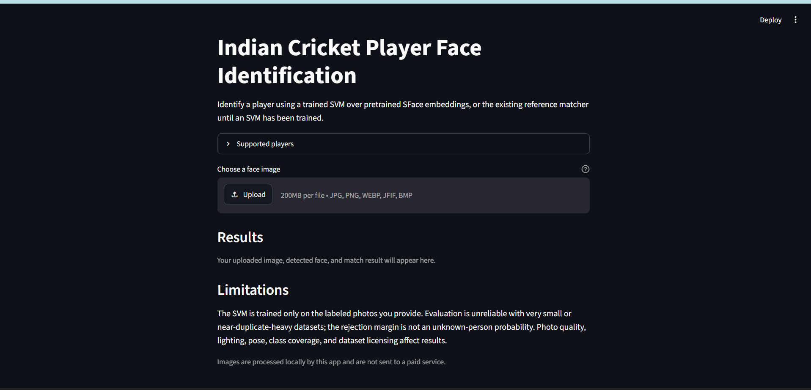
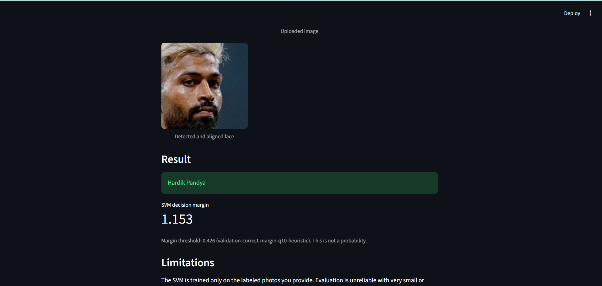
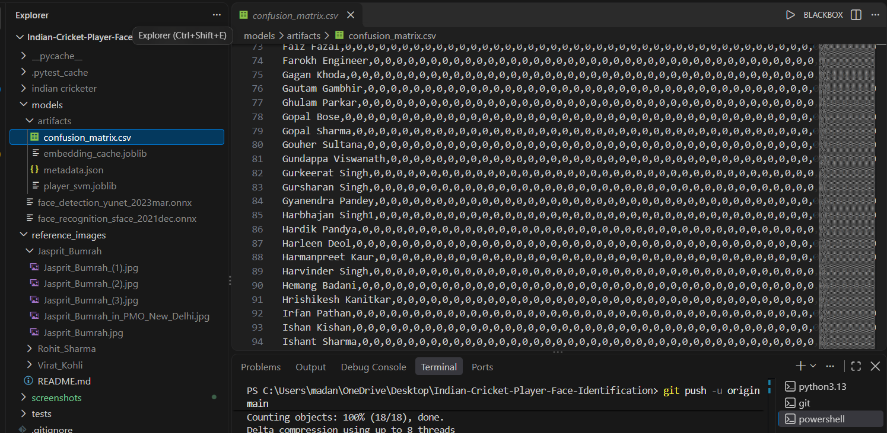

# Indian Cricket Player Face Identification

A local Streamlit application that predicts an Indian cricket player from one face image. It uses OpenCV YuNet for face detection, pretrained OpenCV SFace for face embeddings, and a scikit-learn linear SVM for classification. The app loads the supported roster from the saved classifier and can reject low-margin predictions as **Unknown player**. It runs on CPU and does not train a deep model from scratch.

## Screenshots







## Dataset and photo rights

The source is Avirat Gupta's [Indian Cricketers Dataset on Kaggle](https://www.kaggle.com/datasets/aviratgupta/indian-cricketers-dataset). The Kaggle page displays **CC0: Public Domain**. This page-level label does not independently verify rights for every third-party photograph; those rights have not been independently checked. Review the source and photo terms before redistribution or other reuse.

The extracted dataset is not included in this project. Download it manually from Kaggle only if its terms allow your use, then extract it so the player-name folders are under `indian cricketer/`. The current scan found 324 folders and 7,687 files. The trained model supports 323 classes: all nine Ravi Shastri JPG files were unreadable and provided no usable face embeddings. Do not infer missing labels or fabricate replacement images.

Raw data and reference photos are not included. For reproduction, obtain the dataset from its source subject to the terms, or substitute your own or separately licensed, consented folder-labeled photos. This project does not download or scrape player images.

## Setup

Use Windows PowerShell in the project folder. Install the Python dependencies:

```powershell
py -3 -m venv .venv
.\.venv\Scripts\Activate.ps1
python -m pip install --upgrade pip
python -m pip install -r requirements.txt
```

The YuNet and SFace ONNX weights are not included in GitHub. Download the official OpenCV Zoo model files into `models/`:

```powershell
New-Item -ItemType Directory -Force .\models | Out-Null
Invoke-WebRequest -UseBasicParsing `
  -Uri "https://media.githubusercontent.com/media/opencv/opencv_zoo/main/models/face_detection_yunet/face_detection_yunet_2023mar.onnx" `
  -OutFile ".\models\face_detection_yunet_2023mar.onnx"
Invoke-WebRequest -UseBasicParsing `
  -Uri "https://media.githubusercontent.com/media/opencv/opencv_zoo/main/models/face_recognition_sface/face_recognition_sface_2021dec.onnx" `
  -OutFile ".\models\face_recognition_sface_2021dec.onnx"
```

See the official [YuNet](https://github.com/opencv/opencv_zoo/tree/main/models/face_detection_yunet) and [SFace](https://github.com/opencv/opencv_zoo/tree/main/models/face_recognition_sface) pages for model licenses and terms.

## Train and evaluate

The folder name supplies each class label. Inspect the extracted dataset, validate local setup, train, and reevaluate the saved model with:

```powershell
python inspect_dataset.py --dataset-dir ".\indian cricketer" --csv dataset_inventory.csv
python validate_setup.py
python train_classifier.py --dataset-dir ".\indian cricketer" --seed 42 --workers 2
python train_classifier.py --dataset-dir ".\indian cricketer" --evaluate-only --workers 2
```

Training extracts YuNet/SFace embeddings, groups duplicate photos before splitting, fits the SVM, selects a validation-based rejection margin, and reports held-out metrics and a confusion matrix. Evaluation reuses the embedding cache when inputs are unchanged. Generated model artifacts and caches are local and ignored by Git.

To use the existing `reference_images/` folders instead, omit `--dataset-dir` from the training command. Restart Streamlit after training so its cached classifier and roster reload.

## Results and limitations

For the recorded seed-42 run, **6,371 images from 323 classes** were used: 3,829 train, 1,273 validation, and 1,269 test images. Held-out accuracy was **72.73%** and macro F1 was **0.7414**. These are dataset- and split-specific measurements, not a guarantee of performance on new images. The small per-class test sets can make metrics unstable.

The model uses a validation-derived decision-margin heuristic for Unknown player rejection; it is not a calibrated probability. Evaluation used known-player images only. **Unknown-person false acceptance has not been measured.** False matches and rejections remain possible.

The source scan found 324 folders, but the trained roster contains 323 classes because Ravi Shastri had no usable images. Supporting that class requires valid, correctly labeled source images and retraining.

## Run the app

```powershell
streamlit run app.py
```

Upload a JPG, JPEG, PNG, WEBP, JFIF, or BMP image containing exactly one detectable face. The UI displays the supported-player roster, prediction or Unknown player result, and the SVM margin. The margin is not a probability.

## Tests

```powershell
python -m pytest -q
python -m py_compile app.py face_id.py dataset.py inspect_dataset.py training.py train_classifier.py validate_setup.py tests\test_face_id.py tests\test_dataset.py tests\test_training.py
```
